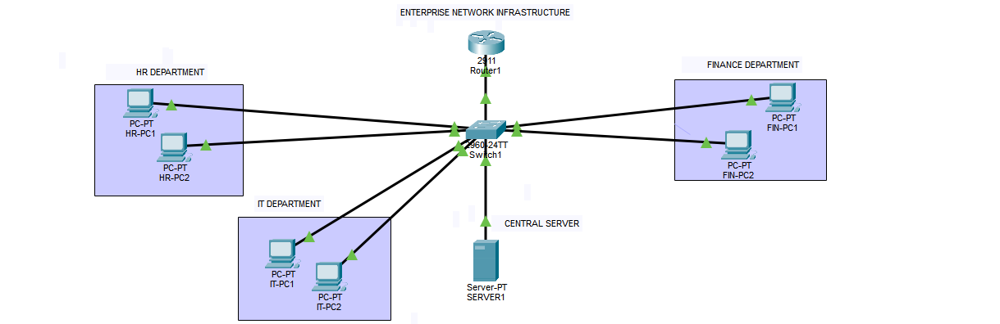

# Networking Projects | Cisco Packet Tracer

Welcome to my networking portfolio! This repository contains hands-on networking projects, practical labs, and networking concepts that I am learning and implementing.

## About Me
I am an Electronics and Communication Engineering graduate interested in Computer Networking, Network Infrastructure, and Network Operations (NOC).

## Technical Skills
- Networking Fundamentals
- OSI and TCP/IP Models
- IPv4 Addressing and Subnetting
- DHCP and DNS
- Routers and Switches
- Cisco Packet Tracer
- Basic Network Troubleshooting

## Projects

### 1. Enterprise Network Infrastructure Using Cisco Packet Tracer
Designed and configured an enterprise network connecting multiple departments through routers and switches.

### Network Topology

**Key implementations:**
- Network topology design
- Static IP addressing
- DHCP configuration
- DNS configuration
- Interdepartmental communication
- Network connectivity testing

**Tools:** Cisco Packet Tracer

## Learning Goals
- Strengthen networking fundamentals.
- Practise routing and switching.
- Learn VLANs and inter-VLAN routing.
- Develop troubleshooting skills.
- Prepare for CCNA certification.

## Contact
- GitHub: https://github.com/kirtanbalajee
